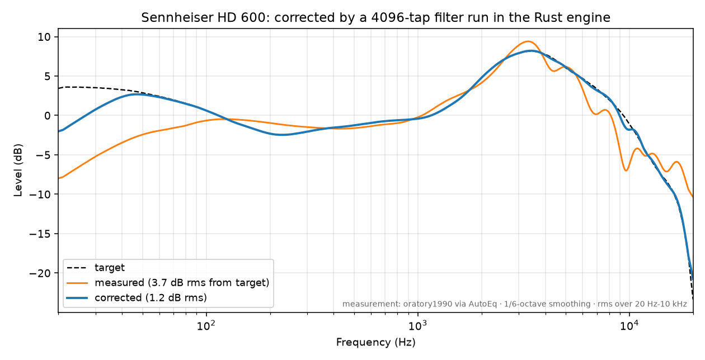

# sweepeq

Measure a loudspeaker's or headphone's frequency response, design a correction filter, and
run it in real time, with every step checked against an independent reference.

- **Measurement** (Python): synchronized exponential sine sweeps, impulse responses,
  harmonic distortion, microphone calibration, smoothing and averaging.
- **Filter design** (Python): regularised inversion with a boost limit, minimum- or
  linear-phase FIR filters, and parametric EQ presets that any equaliser accepts.
- **Real-time engine** (Rust): SIMD FIR and partitioned FFT convolution, allocation-free,
  with a lock-free filter swap; a command-line tool and Python bindings.



*A published Sennheiser HD 600 measurement (oratory1990, via AutoEq), corrected towards
its target by a 4096-tap filter designed by sweepeq and run through the Rust engine: from
3.7 to 1.2 dB RMS from the target over 20 Hz–10 kHz. Below 50 Hz the correction stops at
its +6 dB boost limit on purpose; the headphone would need about 11 dB there.*

## Results

| | |
|---|---|
| Measurement accuracy (simulated device with known response) | 0.003 dB magnitude, delay to 0.01 samples, harmonic levels within 1 dB |
| Correction vs AutoEq on the same measurement and target | same curve to 0.01 dB RMS from 200 Hz to 2 kHz; residual 1.20 dB vs AutoEq's 1.18 dB |
| Parametric EQ fit | a real 10-band preset recovered to 0.05 dB |
| Rust engine vs the Python reference (golden vectors) | within 2.8e-7 of the worst-case output: single-precision rounding |
| Engine cost, 4096-tap filter, one channel (i7-13700H) | 0.03–0.6% of one core, by block size |
| Direct vs partitioned crossover | 128–256 taps |

Each number comes from a test or a script in the repository; the docs below say which.

## Quick start

```bash
uv sync --all-extras
uv run sweepeq simulate                                 # measure a simulated device, no hardware
uv run sweepeq devices                                  # then measure a real one:
uv run sweepeq measure --device pipewire --out m.npz
uv run sweepeq design m.npz --fir eq.wav --peq 8 --apo eq.txt

cargo build --release --manifest-path engine/Cargo.toml
engine/target/release/sweepeq-engine process --filter eq.wav --input in.wav --output out.wav
engine/target/release/sweepeq-engine live --filter eq.wav --watch   # edit eq.wav while it runs
engine/target/release/sweepeq-engine bench
```

`eq.txt` is an Equalizer APO preset, which EasyEffects and most parametric equalisers can
import; `eq.wav` is an FIR filter for a convolver.

## How it is built

| Part | What it does | Docs |
|---|---|---|
| `src/sweepeq/` | Python reference: measurement, analysis, design, comparisons | [measurement](docs/measurement.md), [design](docs/design.md) |
| `engine/sweepeq-core` | Rust convolvers and filter swap | [engine](docs/engine.md) |
| `engine/sweepeq-cli` | `sweepeq-engine`: files, live audio, benchmarks | [engine](docs/engine.md), [benchmarks](docs/benchmarks.md) |
| `engine/sweepeq-py` | Python bindings for the engine | [engine](docs/engine.md) |
| `testdata/` | golden vectors (Python → Rust) and the AutoEq comparison data | |
| `bench/baselines/` | benchmark baselines per machine | [benchmarks](docs/benchmarks.md) |

Every algorithm is implemented from the published sources in
[docs/references.md](docs/references.md): Farina and Novak for the sweep, Müller and
Massarani and Kirkeby for deconvolution and inversion, Wefers for partitioned convolution.

## How it is verified

- **Against known answers:** a simulated device with an exact response for measurement and
  design; closed-form harmonic levels; a real 10-band preset; AutoEq's published
  correction.
- **Across languages:** golden vectors from the Python reference, checked by the Rust
  tests for every kernel and block size, and by the Python bindings against SciPy.
- **For real-time safety:** a counting allocator proves processing (and filter swaps) never
  allocate; Miri, AddressSanitizer and libFuzzer run in CI. The fuzz target was shown to
  catch a planted bug.
- **On hardware:** a first informal check, measuring an EQ preset on headphones with a
  laptop microphone, matched the preset to about 1 dB RMS from 100 Hz to 2 kHz
  ([validation](docs/validation.md)).
- **By review:** the filter design and the engine were reviewed after they were built;
  the bugs found, and the tests that now pin them, are listed in their docs.

## Limits and what I'd do next

- **Calibrated hardware validation is optional future work.** The software is tested
  against exact simulated answers and published data; the one hardware check used a
  laptop microphone. Comparing against REW with a calibrated measurement microphone is
  prepared ([procedure](docs/validation.md)) but not done.
- **ARM:** the NEON kernel exists but has not run on an ARM machine.
- **Live mode** shares all its processing with the tested code but has not been
  verified on real audio devices, and its latency is dominated by the sound server's
  buffer, not the engine.
- **Next:** heavier treble smoothing as a design option (AutoEq's choice), multichannel
  room correction with several microphone positions, and a non-uniformly partitioned
  convolver (Gardner 1995) for low latency with very long filters.

## Development

```bash
uv sync --all-extras
uv pip install ./engine/sweepeq-py      # the engine's Python bindings, for tests/test_engine.py
uv run pytest
cargo test --manifest-path engine/Cargo.toml --workspace --exclude sweepeq-py
pre-commit install
```

## License

MIT. The AutoEq data in `testdata/autoeq/` is MIT-licensed by its author; see the NOTICE
there.
