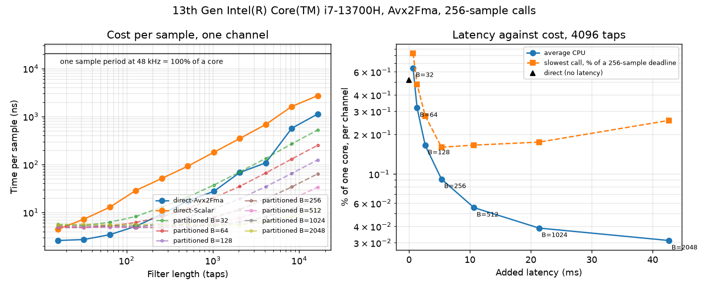

# Benchmarks and latency (M5)

```bash
uv run python tools/bench.py                    # run; compare with this machine's baseline
uv run python tools/bench.py --save-baseline --plot docs/images/bench.png
engine/target/release/sweepeq-engine bench      # the raw JSON, on any machine
```

`sweepeq-engine bench` times every method over filter lengths of 16–16 384 taps: the direct
FIR with the CPU's SIMD kernel and with the portable one, and the partitioned convolver
with blocks of 32–2048 samples. Each case processes one second of 48 kHz audio in
256-sample calls, as an audio callback would, after a warm-up pass; it repeats for at least
0.3 s and three runs and reports the median. It also records the slowest single call (the
median over runs of each run's slowest), because a real-time thread has a deadline per
callback, not per second. `tools/bench.py` pins the run to one performance core (this CPU
mixes performance and efficiency cores), stores per-machine baselines in
[`bench/baselines/`](../bench/baselines/), compares new runs against them, and draws the
charts. CI runs a short benchmark as a smoke test and keeps the JSON, but does not compare
timings: shared runners are too variable.

## Results

Intel Core i7-13700H (laptop), one performance core, AVX2+FMA, one channel:



Time per sample (ns; one sample period at 48 kHz is 20 833 ns):

| Taps | Direct, AVX2 | Direct, scalar | Partitioned, B = 64 | B = 256 | B = 1024 |
|---|---|---|---|---|---|
| 64 | 3.4 | 12.8 | 5.2 | 5.3 | 5.3 |
| 256 | 9.1 | 51.1 | 8.1 | 4.8 | 5.4 |
| 1024 | 27.4 | 178.7 | 20.3 | 7.9 | 5.2 |
| 4096 | 107.9 | 681.4 | 66.4 | 19.1 | 8.1 |
| 16384 | 1128.2 | 2721.8 | 251.5 | 63.9 | 19.2 |

- **Crossover: 128–256 taps.** Below it the direct form wins (no FFT overhead, no
  latency); at 128 taps the two are tied within the noise, and from 256 taps the
  partitioned convolver is faster at any block size of 64 or more.
- **SIMD:** the AVX2+FMA kernel is 4–6.5× faster than the portable one from 64 to
  4096 taps, and only 2.4–2.8× at 8192 and 16 384 taps, where both wait on memory once the
  data leaves the L1 cache.
- **Cache:** the direct form costs 4× more for 8192 taps than for 4096, not 2×: its taps
  and history (32 KB each) no longer fit in the 48 KB L1 data cache.
- **CPU is not the constraint.** A 4096-tap correction costs 0.04–0.6% of one core per
  channel, depending on the block size; even 16 384 taps stay under 0.1% with B ≥ 1024.

### Latency against cost (4096 taps)

| Block B | Added latency | Average CPU | Slowest call | Share of the 256-sample deadline |
|---|---|---|---|---|
| direct | 0 ms | 0.52% | 34.1 µs | 0.64% |
| 32 | 0.67 ms | 0.64% | 44.3 µs | 0.83% |
| 64 | 1.33 ms | 0.32% | 25.6 µs | 0.48% |
| 128 | 2.67 ms | 0.17% | 14.8 µs | 0.28% |
| 256 | 5.33 ms | 0.09% | 8.5 µs | 0.16% |
| 512 | 10.7 ms | 0.06% | 8.8 µs | 0.17% |
| 1024 | 21.3 ms | 0.04% | 9.3 µs | 0.18% |
| 2048 | 42.7 ms | 0.03% | 13.7 µs | 0.26% |

The average keeps falling with the block size, but the slowest call stops improving at
B = 256, the callback size, and grows beyond it: a block larger than the callback does all
its work in one callback out of `B / 256`. So for real-time use, **B should not exceed the
callback size**; larger blocks add latency without making the worst case safer. Below the
callback size, a smaller B trades CPU for latency, and at B = 32 the partitioned convolver
costs more than the direct form.

**Recommendation for a 4096-tap correction:** B equal to the callback size (256 at 48 kHz,
5.3 ms) for playback, where a few milliseconds don't matter; the direct form or B = 64
(1.3 ms) where latency matters, at under 1% of a core either way.

## Latency

The convolver's own latency is exact and tested: 0 samples for the direct form, `B` for the
partitioned one (`tests/convolution.rs`, `tests/golden.rs`, and the CLI test, which removes
it from processed files exactly).

In `sweepeq-engine live`, the total is the sound system's round trip plus `B`. The round
trip through PipeWire on this laptop, measured with `sweepeq measure` (the impulse
response's arrival time), is 61 ms with the default settings; it is set by the sound
server's buffer size (quantum), not by the engine, and dominates any block size up to
1024. A loopback measurement through the engine itself needs a cable from output to input
(with a microphone and speaker, the engine would feed back on itself) and is left for
when that setup exists.

## Repeatability

Two full runs of the same code on this laptop differed by up to 23% on some cases (turbo
frequency and temperature vary between runs, even pinned to one core). The default
regression threshold is therefore 25%: smaller regressions cannot be told from noise on a
laptop. The conclusions above hold across both runs, except that the exact crossover moved
between 128 and 256 taps, where the methods are tied.

## Not covered

- **ARM (NEON):** the kernel is type-checked for AArch64 in CI (clippy), but no ARM machine
  was available to run, test or benchmark it. A Raspberry Pi or an ARM CI runner would
  cover it.
- Multichannel load is the single-channel figure times the channel count; it was not
  measured separately.
