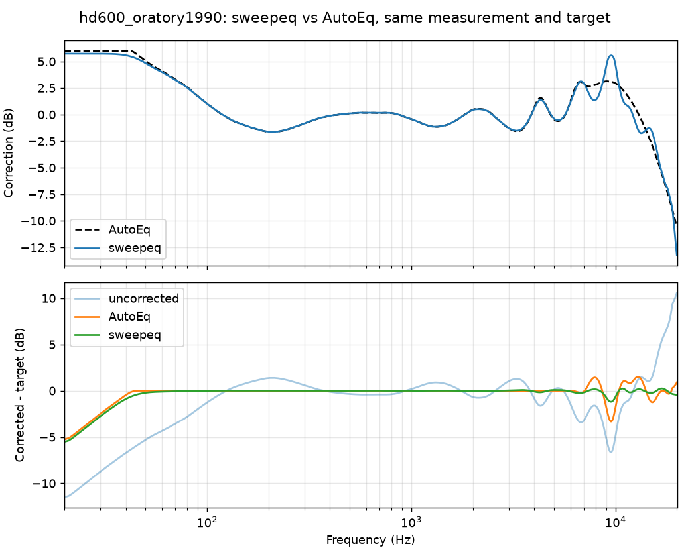

# Correction filter design (M3)

`sweepeq design` turns one or more measurements into a correction filter: an FIR filter
(WAV file, for a convolver such as EasyEffects, CamillaDSP or Equalizer APO) and,
optionally, a parametric EQ (Equalizer APO text, for any parametric equaliser).

```bash
uv run sweepeq design recordings/spk_pos*.npz --cal mic_cal.txt \
    --boost-limit 6 --taps 4096 --phase minimum --fir correction.wav --peq 8 --apo correction.txt
```

## Method

The correction is designed in magnitude, from the measured response after fractional-octave
smoothing (1/6 octave by default): inverting fine, position-dependent detail makes the
result worse a short distance away (Norcross et al. 2004).

1. **Target.** Flat by default, with an optional tilt (dB/octave) and bass shelf, or any
   curve loaded from a text file (e.g. a published headphone target).
2. **Deviation.** Measured minus target, shifted to average 0 dB over 300 Hz–3 kHz, so
   only the shape is corrected, never the overall level.
3. **Peaks are inverted exactly.** Cutting a resonance is always safe (down to a 24 dB
   cut limit).
4. **Dips are inverted with Tikhonov regularisation** (Kirkeby et al. 1998), with the
   prior "no correction" instead of "no output": `C = (d + β)/(d² + β)` for a dip of
   linear depth `d`, which minimises `|d·C - 1|² + β·|C - 1|²`. Shallow dips get the exact
   inverse; the boost peaks for dips of about the *notch depth* (20 dB by default,
   `β = d_notch²`) and falls for deeper ones, reaching 0 dB only for extreme nulls. A deep
   notch is usually a cancellation that moves with position, so chasing it wastes
   headroom.
5. **Boost limit.** Boosts are then capped with a soft knee (6 dB by default): exact for
   boosts well below the limit, never above it.
6. **Band.** Outside the correction band the correction fades to 0 dB over half an octave.
   The band is also limited to the measurement's valid range, inside the deconvolution's
   regularisation tapers: 28 Hz–17.8 kHz for a 20 Hz–20 kHz sweep
   (`deconv.valid_range`). Outside it the measurement rolls off steeply (9 dB at 25 Hz,
   59 dB at 18.5 kHz). Beyond that range the measured curve is held at its edge values,
   so the band-edge fade never reads the roll-off as something to correct.

### FIR filter

Designed by frequency sampling on a dense grid (at least 65 536 points), then cut to the
requested length:

- **Minimum phase:** the phase follows from the magnitude via the real cepstrum (the
  same routine the measurement uses for its band limit). No added latency; a short
  half-Hann taper at the end.
- **Linear phase:** symmetric taps, latency of half the filter length, Hann-windowed.
  No phase distortion, but it needs more taps for the same low-frequency accuracy, and
  the latency rules it out for live monitoring.

The command reports two gains: the largest gain for a sine wave (the preamp to set so that
no tone clips), and the L1 norm of the taps (the strict worst case for any signal, usually
well above it).

### Parametric EQ

The parametric EQ approximates the same correction with a few peaking and shelving biquads
(RBJ cookbook):

1. **Greedy start.** Shelves where the bass or treble correction averages at least 1 dB,
   then peaking filters placed one at a time at the largest remaining error, with its
   gain and a bandwidth from where the error halves.
2. **Joint refinement** of all frequencies, gains and Q values by bounded nonlinear least
   squares (`scipy.optimize.least_squares`), with a very small penalty on each filter's
   gain. Without it, the fit often found pairs of large, opposing filters that cancel
   (e.g. −9.5 dB at Q 0.3 next to +6 dB at Q 0.5); with it, the same correction comes out
   as the filters a person would set.
3. **Preamp** of minus the EQ's largest gain anywhere up to Nyquist, so it cannot clip.

## Validation (tests/test_design.py)

A simulated device with four EQ bands (+6 dB at 100 Hz, −6 dB at 1 kHz, −8 dB at 3 kHz,
+5 dB at 8 kHz), corrected to flat over 40 Hz–16 kHz without smoothing:

| Phase | Taps | Latency | FIR vs designed correction (100 Hz–16 kHz) | Corrected response (60 Hz–12 kHz) |
|---|---|---|---|---|
| minimum | 1024 | 0 ms | 0.22 dB | ±0.38 dB |
| minimum | 4096 | 0 ms | 0.01 dB | ±0.33 dB |
| minimum | 16384 | 0 ms | 0.00 dB | ±0.33 dB |
| linear | 1024 | 10.7 ms | 1.80 dB | ±1.92 dB |
| linear | 4096 | 42.7 ms | 0.17 dB | ±0.33 dB |
| linear | 16384 | 170.7 ms | 0.01 dB | ±0.33 dB |

The remaining ±0.33 dB is the regularisation of the 8 dB dip, by design.

Other checks:

- **Boost limit:** a device with a 40 dB, Q 30 notch gets at most +6 dB anywhere; the FIR
  filter's peak gain stays within 0.2 dB of the limit.
- **Deep dips:** beyond the notch depth, every deeper dip gets less boost; an 80 dB null
  gets under 0.1 dB.
- **Outside the band:** under 0.5 dB of correction.
- **Phase:** the linear-phase taps are symmetric with the expected latency; the
  minimum-phase filter has 90% of its energy in its first 50 taps.
- **Level:** a device 10 dB louder gets exactly the same correction.
- **Parametric EQ round trip:** fitting the curve of a real 10-band headphone preset
  ([data/headphone_preset_apo.txt](data/headphone_preset_apo.txt)) recovers it to within
  0.05 dB, preamp included.
- **Parametric EQ of the simulated device's correction:** 4 filters 1.2 dB RMS, 6 filters
  0.24 dB, 8 filters 0.07 dB.

## Comparison with AutoEq

[AutoEq](https://github.com/jaakkopasanen/AutoEq) publishes corrections for thousands of
headphones. Its results for the Sennheiser HD 600, measured by oratory1990, are in
[`testdata/autoeq/`](../testdata/autoeq/) (MIT-licensed, see the NOTICE there): the
measurement, the target, and AutoEq's correction. sweepeq designed its own correction from
the same measurement and target, with the same +6 dB boost limit
([`tools/compare_autoeq.py`](../tools/compare_autoeq.py), checked by
`tests/test_autoeq.py`):

| Band | sweepeq − AutoEq correction (level removed): RMS | Max |
|---|---|---|
| 20–200 Hz | 0.21 dB | 0.52 dB |
| 200 Hz–2 kHz | 0.01 dB | 0.03 dB |
| 2–6 kHz | 0.07 dB | 0.19 dB |
| 6–10 kHz | 1.22 dB | 2.49 dB |
| 10–20 kHz | 0.97 dB | 2.67 dB |

| Headphone vs target, 20 Hz–10 kHz (1/6 octave) | RMS | Max |
|---|---|---|
| Uncorrected | 3.73 dB | 11.5 dB |
| AutoEq correction | 1.18 dB | 5.25 dB |
| sweepeq correction | 1.20 dB | 5.52 dB |
| AutoEq 10-band parametric EQ | 1.27 dB | 5.10 dB |



- **Below 6 kHz the two corrections are the same curve** to within 0.03 dB from 200 Hz to
  2 kHz. Below 50 Hz they differ by up to 0.5 dB: both hit the +6 dB limit there,
  sweepeq with a soft knee (5.75 dB) and AutoEq with a hard cap.
- **Above 6 kHz they differ by design.** AutoEq follows the treble more loosely and leaves
  the 9.5 kHz peak and notch partly uncorrected; sweepeq follows the 1/6-octave detail.
  That does not make sweepeq better: treble measurements depend on how the headphone sits,
  so not chasing treble detail is a reasonable choice, and heavier treble smoothing would be
  a natural option to add.
- **The residual 5 dB is the bass below 50 Hz,** which needs about 11 dB of boost and gets
  6 dB from both tools.

## Review fixes

A review after M3 found two bugs, each now covered by a test that fails without the fix:

- **`sweepeq design` left the treble uncorrected.** It limited the correction to
  `[2·f1, f2/2]`, the conservative band the M1 tests use (40 Hz–10 kHz for a
  20 Hz–20 kHz sweep), although the measurement is accurate to within 0.01 dB from 28 Hz
  to 17.8 kHz. A +6 dB peak at 14 kHz went uncorrected. The band now reaches the edges of
  the regularisation tapers, with the measured curve held beyond them.
- **Unsupported filters in an APO preset were silently dropped.** A preset with a
  high-pass, low-pass or notch filter was read as if that filter did not exist. Enabled
  filters of unsupported types are now an error.

Still to do: correcting a real measurement once the M2 microphone setup is in place.
