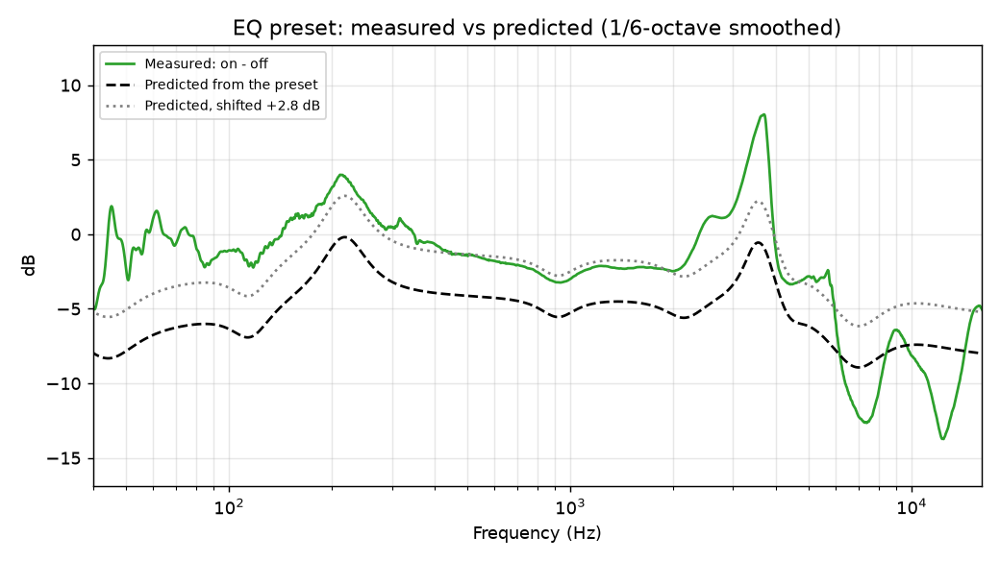

# Validation against REW (optional)

This is optional future work: it needs a calibrated measurement microphone (for example
a miniDSP UMIK-1). The software it exercises is already tested against simulated devices
with exact answers and against published data.

Target: sweepeq's measurement of a real loudspeaker agrees with Room EQ Wizard (REW) on the
same setup to within ±1 dB from 50 Hz to 10 kHz, both with 1/6-octave smoothing and
normalised at 1 kHz.

## Setup

- Loudspeaker, a USB measurement microphone with its calibration file, and a sound card
  (the USB microphone's own interface is fine for the input).
- Microphone on a stand at about 0.5 m from the speaker, on its axis, away from walls.
- Do not move anything between the sweepeq and REW measurements.
- Set the level once so the sweep is clearly audible but nowhere near clipping (sweepeq
  warns if the recording peaks above −0.1 dBFS).

- **Bypass any system audio effects** (EasyEffects, PulseEffects, PipeWire filter chains,
  the laptop vendor's "audio enhancement"): EQ, compression and noise suppression on the
  output or the microphone input change what is measured. In EasyEffects, use the global
  bypass for both output and input, and keep it bypassed for the REW measurement too.
- `sweepeq measure` prints the latency and the impulse response's peak-to-noise ratio, and
  warns below 40 dB (on a first laptop test, a microphone hearing only headphone leakage
  gave 23 dB; the earcup held against it gave 46 dB).

## Procedure

```bash
uv sync --all-extras
uv run sweepeq devices                       # find the device index
uv run sweepeq measure --device N --out recordings/spk_pos1.npz
# optional: two more microphone positions, a few cm apart
uv run sweepeq measure --device N --out recordings/spk_pos2.npz
uv run sweepeq measure --device N --out recordings/spk_pos3.npz
```

In REW: measure the same speaker with the same microphone, calibration file and positions
(a 20 Hz–20 kHz sweep), average the positions if more than one, then *File → Export →
Export measurement as text*, saved as `recordings/rew.txt`.

```bash
uv run sweepeq analyse recordings/spk_pos*.npz --cal <mic calibration file> \
    --compare recordings/rew.txt --plot docs/images/rew_comparison.png
```

The command prints the largest difference over 50 Hz–10 kHz. `recordings/` is ignored by
git; only the plot and the numbers below are published.

## Results

To be filled in after the measurement:

| Device | Positions | Max difference, 50 Hz–10 kHz |
|---|---|---|
| | | |


## Known differences to expect

- **Windowing.** Neither tool gates out room reflections by default, so both measure the
  speaker in the room. Small differences at low frequencies come from REW's and sweepeq's
  different impulse-response window lengths.
- **Smoothing.** Both smooth in power over 1/6 octave, but window shapes may differ
  slightly; differences show at sharp peaks and notches.
- **Absolute level.** Not compared: REW calibrates to SPL, sweepeq reports relative level.

## Informal first check: measuring an EQ preset on real hardware

Before the REW validation, a first real-hardware check of the whole chain: measure a pair of
wired headphones twice, without and with a parametric EQ preset (EasyEffects, 10 bands, in
[`data/headphone_preset_apo.txt`](data/headphone_preset_apo.txt)), and compare the measured
difference with the curve the preset's settings predict
([`tools/compare_preset.py`](../tools/compare_preset.py)). The setup is deliberately crude:
one earcup held against a laptop's built-in microphone, uncalibrated, not sealed.

```bash
uv run python tools/compare_preset.py off.npz on.npz docs/data/headphone_preset_apo.txt \
    --fs-eq 96000 --plot docs/images/preset_vs_measured.png
```

Both measurements: 3 s sweep at −20 dBFS, latency 61 ms, peak-to-noise 70 and 73 dB, no
clipping.

| Band | Shape error (RMS, after removing a +2.8 dB level offset) | Max |
|---|---|---|
| 100 Hz–2 kHz | 1.2 dB | 2.9 dB |
| 2–5 kHz | 2.7 dB | 6.2 dB |
| 5–16 kHz | 4.6 dB | 8.9 dB |



What it shows:

- Where the acoustic setup is stable (100 Hz–2 kHz) the measured EQ follows the predicted
  one to about 1 dB, including a +4.4 dB, Q 2.7 bump at 217 Hz.
- Above 2 kHz the shape is right but the levels are not: an unsealed earcup on a laptop
  microphone changes by several dB with millimetres of movement there, and the largest error
  sits in a deep notch of the headphones at 3.6 kHz, where a tiny shift moves the level a
  lot. Below 100 Hz the leak in the seal dominates.
- The +2.8 dB level offset (part of the preset's −4.2 dB preamp not showing) is not
  explained by this data: a slightly different earcup pressure between the runs is the
  likely cause.

So the processing chain works on real audio I/O; the remaining errors are the setup's. The
±1 dB target above still needs the measurement microphone.

Practical lessons from getting this run, all with PipeWire:

- **Address devices by name** (`--device pipewire`), not by index: indices shift when
  PipeWire opens or releases hardware devices, and an index that pointed at the PipeWire
  device one minute pointed at a different device the next.
- **Closing the EasyEffects window does not stop it.** Its background service keeps its
  virtual sink and keeps moving new application streams into it; with the effects bypassed
  nothing was forwarded to the headphones, so the sweep was silent. `easyeffects -q` stops
  it.
- **Mind the headroom.** Without the preset's −4.2 dB preamp, full system volume made the
  headphone output distort, and with the earcup sealed over the microphone a −14 dBFS sweep
  clipped the input; −20 dBFS did not.
